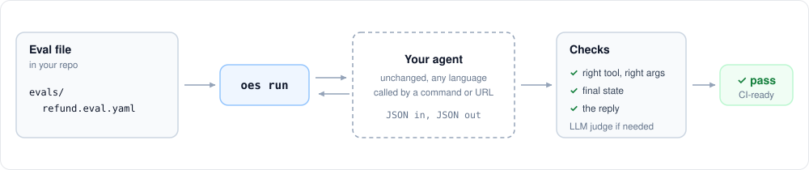

<p align="center">
  <picture>
    <source media="(prefers-color-scheme: dark)" srcset="docs/logo-dark.svg">
    
  </picture>
</p>

<p align="center"><b>Write agent evals in YAML. Run them against any agent from any provider in any language.</b></p>

Your agent stays as it is. The runner calls it through a command or a URL, checks what comes back (the reply, the tools it called, the state it ends in) and passes or fails, so it drops straight into CI.



```yaml
# evals/refund-agent.eval.yaml
oes: 1
name: refund-agent
target: {command: "python agent.py"}          # or {http: "http://localhost:8000/eval"}
scorers:                                       # the names are your own choice
  - {name: refunds, check: tool_called, pass: {each: 1}}
  - {name: order-refunded, check: equals, pass: {each: 1}}
  - {name: never-deletes, check: tool_not_called, pass: {each: 1}}
  - {name: says-timeline, check: reply_contains, pass: {mean: 0.9}}
cases:
  - id: damaged-item
    input:
      message: "My order 1042 arrived broken. Can I get my money back?"
      state: {orders: {"1042": {total: 20, status: delivered}}}
    expected:                                  # what each scorer expects, by name
      refunds: [{name: refund, args: {order_id: "1042", amount: 20}}]
      order-refunded: {state.orders.1042.status: refunded}
      never-deletes: [delete_order]
      says-timeline: ["5 business days"]
```

With a second case, `wrong-order`, that the agent gets wrong:

```console
$ oes run evals/refund-agent.eval.yaml
refund-agent: failed
  refunds: value=0.5 passed=False failing=['wrong-order']
  order-refunded: value=0.5 passed=False failing=['wrong-order']
  never-deletes: value=0.5 passed=False failing=['wrong-order']
  says-timeline: value=0.5 passed=False failing=['wrong-order']
```

## Samples

Each sample shows the `scorers` and `cases` of an eval. Every eval also starts with `oes: 1`, a `name` and a `target`, as above. More in the [cookbook](docs/cookbook.md): replaying a conversation, custom checks in any language, latency and cost gates, files and images, cases in a separate file, and reading the results.

### Checking the reply

Text the reply must, or must never, contain. Matching ignores case.

```yaml
scorers:
  - {name: explains-refunds, check: reply_contains, pass: {mean: 0.9}}
  - {name: no-promises, check: reply_not_contains, pass: {each: 1}}
cases:
  - id: refund-policy
    input: {message: "How do refunds work?"}
    expected:
      explains-refunds: ["refund", "5 business days"]
      no-promises: ["guaranteed", "instantly"]
```

### Checking structured output

For classifiers and extractors that return data instead of text. A path picks a value out of the output.

```yaml
scorers:
  - {name: routed, check: equals, pass: {mean: 0.9}}
cases:
  - id: charged-twice
    input:
      data: {subject: "Charged twice", body: "I was billed two times for one order."}
    expected:
      routed: {data.queue: billing, data.priority: high}
```

### Checking tool calls

Tools the agent must call, with the arguments that matter, and tools it must never call.

```yaml
scorers:
  - {name: looks-up-order, check: tool_called, pass: {each: 1}}
  - {name: no-cancel, check: tool_not_called, pass: {each: 1}}
cases:
  - id: where-is-my-order
    input: {message: "Where is order 1042?"}
    expected:
      looks-up-order: [{name: get_order, args: {order_id: "1042"}}]   # other args are ignored
      no-cancel: [cancel_order, delete_order]
```

### Simulating a user

An LLM plays the user from a short description, so the conversation can react to what the agent says.

```yaml
scorers:
  - {name: solved, judge: goal-completion, pass: {mean: 0.8}}
cases:
  - id: wifi-after-update
    input:
      persona: >
        A calm adult whose laptop stopped joining wifi after an update.
        Other devices work; say so only if asked. Stop when it works.
      max_turns: 20
      stop_when: [{state.solved: true}, {state.handed_off: true}]   # either ends it
    expected:
      solved: ["Asks what changed before suggesting fixes."]
```

### Testing a coding agent

Give the agent a repo and a task, follow up, then run the repo's tests. Each try gets its own copy of the repo.

```yaml
scorers:
  - name: tests-pass
    check: {command: "python evals/checks/run_tests.py"}   # reads output.data.repo
    pass: {mean: 0.8}
cases:
  - id: add-due-date
    input:
      data:
        repo: {type: file, path: fixtures/todo-app}       # a folder
        task: Add an optional due date to each todo item.
      script:
        - {data: {task: Now add tests for the due date.}}  # merged into data
    expected:
      tests-pass: {min_passing: 4}
```

### Grading with an LLM judge

For what code can't check. A judge is a small file, answers pass or fail, and gets each case's criteria.

```yaml
# evals/judges/faithful.judge.yaml
name: faithful
prompt: |
  Does the summary state only facts found in the document?
  Pass if every claim is supported. Fail if any claim is not.
```

```yaml
scorers:
  - {name: faithful-summary, judge: faithful, pass: {mean: 0.9}}
cases:
  - id: q3-report
    input:
      data: {document: {type: file, path: fixtures/q3-report.pdf}}
    expected:
      faithful-summary: ["Mentions the revenue drop.", "Doesn't invent figures."]
```

The runner reaches models through `OES_LLM_COMMAND`, a small script you write for whichever provider you use.

### Running several tries

Agents don't answer the same way twice. Run each case a few times. `each` means every try must pass, and `mean` sets a pass rate. A whole-run check can report pass@k.

```yaml
trial_count: 5
scorers:
  - {name: never-leaks, check: reply_not_contains, pass: {each: 1}}   # all 5 tries
  - {name: helpful, judge: helpful, pass: {mean: 0.8}}                # 4 out of 5
  - name: helpful-at-5
    check: {command: "python evals/checks/pass_at_k.py"}
    scope: run                                                         # once, over every try
    params: {scorer: helpful, mode: any}
    pass: {min: 0.9}
cases:
  - id: account-question
    input: {message: "What's on my account?"}
    expected:
      never-leaks: ["password", "card number"]
```

## Why OES

- **Your agent stays as it is.** It's tested through a command or a URL, so it can be Python, TypeScript, Go, a CLI or a deployed service. There's no SDK to import.
- **Checks you can trust.** Code checks come first, and LLM judges answer pass or fail. A test that couldn't run is reported as not evaluated, never as a pass.
- **Your coding agent can write them.** The format is small, has a schema and comes with a skill.
- **Plain files, not a platform.** Any conforming runner can run them. The Python and TypeScript runners pass the same [conformance suite](conformance/), and results are plain JSON you can send anywhere.

## Run it

```bash
uvx --from "git+https://github.com/bassimeledath/open-eval-standard#subdirectory=runners/python" oes run evals/refund-agent.eval.yaml
```

It exits 0 when the eval passes, 1 when it doesn't and 2 when the eval itself is invalid. There's also a [TypeScript runner](runners/typescript/).

## Use it with a coding agent

Install the skill, then ask your coding agent to "add OES evals to this project".

```bash
npx skills add bassimeledath/open-eval-standard
```

Or copy `skills/oes/` into your agent's skills folder.

## How it fits with what you already use

### Test frameworks: pytest, DeepEval

These test your code from the inside: import a function, call it, check what it returns. OES tests the running agent from the outside, the way Hurl tests an HTTP API, so it works for any agent in any language and the tests live as plain files. Use both: a test framework for the logic in your code, OES for the agent as a whole.

### Eval and observability platforms: Braintrust, LangSmith, Langfuse, Arize

These store runs, show traces, compare experiments and monitor production. Keep using them. OES defines the evals themselves, as files in your repo: run them with `oes` in CI and send the results to your platform to look at. If you switch platforms, your eval files don't change.

## Read more

- [Design](DESIGN.md): what OES is and why, in plain language.
- [Spec](skills/oes/SPEC.md): the full format.
- [Cookbook](docs/cookbook.md): a short sample for every kind of eval.
- [Examples](skills/oes/examples/): five complete evals, with their fixtures and checks.

## License

MIT
