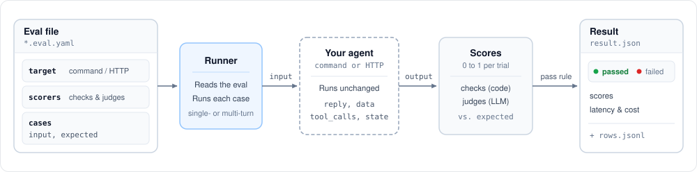

# Open Eval Standard (OES)

A dead simple standard for testing AI agents. Plain YAML files, any language, any model provider.



Every test case is one of two kinds:

| Kind | What it does |
|---|---|
| **Single-turn** | Calls the agent once. Ask a question, label a ticket, extract a PDF. |
| **Multi-turn** | Calls it several times in a row, with fixed inputs or an AI playing the user. A coding task with follow-ups, a support chat. |

```yaml
oes: 1
name: capitals
target: {http: "http://localhost:8000/eval"}   # where to reach your agent
scorers:
  - {name: knows-capital, check: reply_contains, pass: {mean: 0.9}}   # any name you like
cases:
  - id: france
    input:
      message: What is the capital of France?
    expected:
      knows-capital: [Paris]     # under the scorer's name: the reply must mention Paris
```

## Use it with a coding agent

Install the skill, then ask your coding agent to "add OES evals to this project".

```bash
npx skills add bassimeledath/open-eval-standard
```

Or copy `skills/oes/` into your agent's skills folder.

## Read more

- [Design](DESIGN.md): what OES is and why, in plain language.
- [Spec](skills/oes/SPEC.md): the full format.
- [Examples](skills/oes/examples/): a coding agent, invoice extraction, a ticket classifier, a refund agent with tools, and a support chat with a simulated user.

## Status

Draft. The standard may change before version 1 is final.

MIT license.
